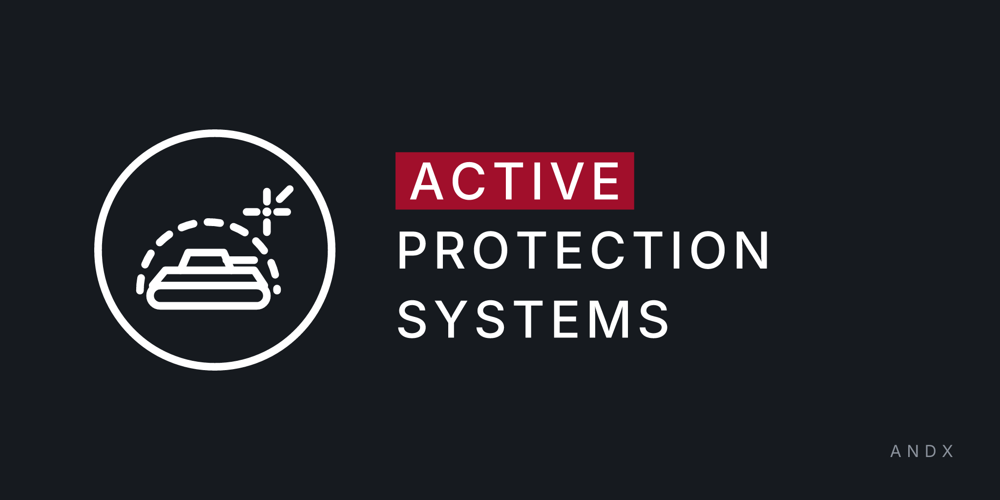

# Active Protection Systems

    

    
    
    
     
    
    

> [!NOTE]
> Not released. This repo keeps the APS code that was removed from ITC Land Systems Redux; there is no Workshop item or release yet.

__Requires__ [CBA_A3](https://github.com/CBATeam/CBA_A3) and [ACE3](https://github.com/acemod/ACE3).

__Active Protection Systems__ (APS) intercept incoming rockets and missiles before they hit the vehicle. The APS was part of [ITC Land Systems Redux](https://github.com/Andx667/ITC_Land_Systems) and is now its own mod.

The project is entirely __open-source__ and any contributions are welcome.

Steam Workshop: <https://steamcommunity.com/sharedfiles/filedetails/?id=0>
Discord: <https://discord.gg/ag4v6kxYAa>

## Features

- Trophy on the M2A1 Slammer, Drozd on the T-100 Varsuk and Afghanit on every T-140 Angara
- Each module has its own arc, range, shots, reload time and kill chance; the arcs turn with the turret
- Works in multiplayer: module ammo and reload state stay consistent with several shooters
- Fit an APS to any vehicle through its config
- CBA setting to switch the APS off server-wide

Documentation: <https://andx667.github.io/active-protection-systems/>

## Contributing

For new contributors, see the [Contributing Setup & Guidelines](./.github/CONTRIBUTING.md).

## License

Active Protection Systems is licensed under [MIT](./LICENSE).
